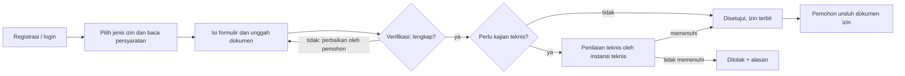

# PRD — Portal Data Perizinan Berusaha dan Nonberusaha (PANDU LOTIM / SIDE SMART)

Nov 17, 2026 · @Krisna Pranata

## 1. Ringkasan

PANDU LOTIM (Portal Administrasi dan Data Usaha Lombok Timur) adalah portal satu pintu milik DPMPTSP Kabupaten Lombok Timur. Portal ini menyatukan empat fungsi: database perizinan 2021–2025, pengajuan izin nonberusaha (KKPR) online, pusat informasi investasi, dan pusat data & analisis. Sistem pengelola di belakangnya bernama SIDE SMART (Sistem Informasi Data Elektronik Smart).

| Unsur KAK   | Isi                                                                                                                                            |
|-------------|------------------------------------------------------------------------------------------------------------------------------------------------|
| Program     | Pengelolaan Data dan Sistem Informasi Penanaman Modal                                                                                          |
| Kegiatan    | Pengelolaan Data dan Informasi Perizinan dan Non Perizinan yang Terintegrasi pada Tingkat Daerah Kabupaten/Kota                                |
| Subkegiatan | Pengolahan, Penyajian dan Pemanfaatan Data dan Informasi Perizinan Berbasis Sistem Pelayanan Perizinan Berusaha Terintegrasi secara Elektronik |
| Spesifikasi | Aplikasi Portal Data Perizinan Berusaha dan Nonberusaha                                                                                        |

**Masalah yang diselesaikan:**

- Data perizinan OSS-RBA dan nonOSS tersebar dan sulit direkap untuk laporan.

- Pemohon izin nonberusaha harus datang ke kantor dan sulit memantau status permohonannya.

- Calon investor tidak punya satu sumber resmi untuk melihat peluang dan proyek investasi di Lombok Timur.

## 2. Tujuan dan metrik keberhasilan

Portal berhasil bila seluruh data perizinan 2021–2025 bisa dicari dan direkap dari satu tempat, dan izin KKPR nonberusaha bisa diajukan tanpa datang ke kantor.

| Tujuan                           | Metrik                                                    | Target awal      |
|----------------------------------|-----------------------------------------------------------|------------------|
| Database perizinan lengkap       | Persentase data OSS-RBA dan nonOSS 2021–2025 yang termuat | 100% baseline    |
| Layanan izin nonberusaha digital | Permohonan KKPR nonberusaha yang masuk online             | Belum ditetapkan |
| Status permohonan transparan     | Permohonan yang statusnya bisa dipantau pemohon           | 100%             |
| Laporan lebih cepat              | Waktu menyusun rekap perizinan bulanan                    | Belum ditetapkan |
| Promosi investasi                | Portofolio proyek yang tayang dengan data lengkap         | Belum ditetapkan |

Angka target yang belum ditetapkan perlu disepakati dengan DPMPTSP sebelum pengembangan dimulai.

## 3. Pengguna dan peran

Portal melayani enam peran. Hak aksesnya dibedakan karena sebagian data perizinan memuat identitas pribadi pemohon.

| Peran            | Siapa                                 | Yang bisa dilakukan                                                                  |
|------------------|---------------------------------------|--------------------------------------------------------------------------------------|
| Publik           | Masyarakat umum                       | Melihat informasi investasi, statistik ringkas, dan persyaratan izin                 |
| Calon investor   | Investor lokal, nasional, asing       | Melihat portofolio dan peta potensi, mengunduh profil proyek, menghubungi DPMPTSP    |
| Pemohon          | Warga atau badan yang mengajukan izin | Registrasi, mengajukan KKPR nonberusaha, unggah dokumen, memantau status, unduh izin |
| Petugas DPMPTSP  | Front office dan verifikator          | Verifikasi administrasi, meneruskan ke instansi teknis, mengelola database perizinan |
| Instansi teknis  | Dinas terkait (mis. PUPR, Bappeda)    | Penilaian teknis dan memberi rekomendasi pada permohonan yang diteruskan             |
| Admin / pimpinan | Admin sistem dan pimpinan DPMPTSP     | Mengelola pengguna, master data, konten investasi; melihat dashboard dan laporan     |

## 4. Ruang lingkup

KAK mewajibkan tiga menu utama; fungsi keempat (Pusat Data & Analisis) ditampilkan sebagai menu tersendiri.

**Struktur menu:**

1.  Beranda — ringkasan angka perizinan dan investasi, pintu ke tiap layanan

2.  Database Perizinan

    1.  Perizinan Berusaha (OSS-RBA)

    2.  Perizinan Nonberusaha (NonOSS)

3.  Layanan Perizinan Nonberusaha (Izin KKPR)

    1.  Persyaratan dan alur

    2.  Ajukan permohonan

    3.  Lacak status

4.  Informasi Investasi

    1.  Portofolio investasi

    2.  Peta potensi investasi

5.  Data & Analisis — statistik dan rekapitulasi

6.  Akun — registrasi, login, permohonan saya

**Termasuk:**

- Impor dan pengelolaan data perizinan 2021–2025

- Pengajuan dan pemrosesan izin KKPR nonberusaha secara online

- Konten portofolio dan peta potensi investasi

- Dashboard statistik dan ekspor laporan

**Tidak termasuk:**

- Pengajuan perizinan berusaha (tetap melalui OSS-RBA nasional)

- Pembayaran retribusi online

- Tanda tangan elektronik tersertifikasi BSrE, kecuali disepakati kemudian

## 5. Modul 1 — Database Perizinan

Modul ini menghimpun data perizinan berusaha (OSS-RBA) dan nonberusaha (NonOSS) baseline 2021–2025 dalam satu basis data yang bisa dicari, difilter, direkap, dan diekspor.

### 5.1 Database Perizinan Berusaha (OSS-RBA)

Struktur mengikuti file ekspor OSS-RBA yang dipakai sebagai data uji. Satu baris = satu **proyek**, bukan satu usaha: satu NIB bisa punya beberapa proyek (di data uji, satu perusahaan muncul di tiga baris).

| Kolom sumber (ekspor OSS)                              | Kebutuhan KAK    | Contoh nilai di data uji                   | Catatan                                                                          |
|--------------------------------------------------------|------------------|--------------------------------------------|----------------------------------------------------------------------------------|
| Id Proyek                                              | — (kunci baris)  | R-2019121623…                              | Unik per proyek; dipakai mencegah duplikat saat impor                            |
| Uraian Jenis Proyek                                    | —                | Utama, Pendukung                           |                                                                                  |
| NIB                                                    | NIB              | 9120004303…                                | Disimpan sebagai teks agar digit tidak terpotong                                 |
| Nama Perusahaan                                        | Identitas usaha  | UD. Dias Kas…, CV. Yumasa…                 |                                                                                  |
| Uraian Jenis Perusahaan                                | Identitas usaha  | Perorangan                                 |                                                                                  |
| Nama Proyek                                            | Identitas usaha  | Industri rokok, penangkapan ikan           |                                                                                  |
| KBLI + Judul KBLI                                      | KBLI             | 12019 — Industri Rokok…                    | KBLI 5 digit disimpan sebagai teks (contoh 03112)                                |
| KL/Sektor Pembina                                      | Sektor usaha     | Kementerian Perindustrian, Kementerian KP  | Dipetakan ke sektor KAK (pertanian, perikanan, perdagangan, pariwisata, lainnya) |
| Uraian Skala Usaha                                     | Skala usaha      | Usaha Mikro, Usaha Kecil                   |                                                                                  |
| Uraian Risiko Proyek                                   | — (tambahan)     | Rendah, Menengah Rendah, Tinggi            | Layak jadi filter                                                                |
| Uraian Status Penanaman Modal                          | — (tambahan)     | PMDN                                       | PMA/PMDN, layak jadi filter                                                      |
| Alamat Usaha, Kab/Kota, Kecamatan, Kelurahan           | Lokasi usaha     | Masbagik, Sakra Timur, Aikmel, Pringgabaya |                                                                                  |
| Tanggal Terbit Proyek                                  | Tahun penerbitan | 04/10/2018, 03/03/2019                     | Tahun diambil dari kolom ini                                                     |
| Kolom tanggal kedua (judul terpotong “Day of Tangga…”) | —                | 6 Juni 2022, 21 Oktober 2022               | Arti kolom perlu dipastikan                                                      |
| Luas Tanah + Satuan Tanah                              | — (tambahan)     | 200 m2                                     |                                                                                  |
| Jumlah Investasi                                       | Nilai investasi  | Rp150.000.000                              | Rupiah                                                                           |
| TKI                                                    | — (tambahan)     | 3, 20                                      | Jumlah tenaga kerja Indonesia                                                    |

**Status izin** yang diminta KAK (aktif, dicabut) tidak ada di data uji. Kolom ini perlu diambil dari sumber lain atau diisi petugas.

**Aturan rekap dari data uji:** jumlah usaha = jumlah NIB unik; jumlah proyek = jumlah baris; nilai investasi = jumlah kolom Jumlah Investasi. Impor wajib menyeragamkan format tanggal, karena data uji mencampur 04/10/2018 dan 6 Juni 2022.

### 5.2 Database Perizinan NonOSS

Basis data seluruh perizinan nonberusaha yang diterbitkan atau difasilitasi DPMPTSP. Field: nama pemohon, jenis perizinan, nomor izin, tanggal permohonan, tanggal penerbitan, lokasi objek perizinan, status permohonan, dokumen perizinan, dan instansi teknis terkait. Permohonan KKPR yang selesai di Modul 2 otomatis masuk ke database ini.

### 5.3 Kebutuhan fungsional

| Kode  | Kebutuhan                                                                      | Prioritas |
|-------|--------------------------------------------------------------------------------|-----------|
| DB-01 | Pencarian berdasarkan NIB dan nama usaha                                       | Wajib     |
| DB-02 | Filter berdasarkan tahun, sektor, dan kecamatan (juga skala, KBLI, status)     | Wajib     |
| DB-03 | Rekapitulasi jumlah usaha per filter yang aktif                                | Wajib     |
| DB-04 | Ekspor hasil filter ke Excel dan PDF untuk laporan                             | Wajib     |
| DB-05 | Impor data dari file ekspor OSS-RBA (Excel/CSV) dengan validasi duplikat NIB   | Wajib     |
| DB-06 | Input dan edit manual data NonOSS oleh petugas, dengan riwayat perubahan       | Wajib     |
| DB-07 | Halaman detail per usaha atau per izin                                         | Wajib     |
| DB-08 | Tampilan publik hanya data agregat; data rinci dan dokumen hanya untuk petugas | Wajib     |

## 6. Modul 2 — Pengajuan Izin Nonberusaha Online (KKPR)

Pemohon mengajukan izin KKPR nonberusaha dari rumah dan memantau statusnya sampai dokumen izin bisa diunduh, tanpa datang ke kantor DPMPTSP.

### 6.1 Status permohonan

| Status           | Arti                                                   | Siapa yang bertindak |
|------------------|--------------------------------------------------------|----------------------|
| Draf             | Formulir belum dikirim                                 | Pemohon              |
| Diajukan         | Masuk antrean verifikasi                               | Petugas DPMPTSP      |
| Perlu perbaikan  | Dokumen kurang atau salah, dikembalikan dengan catatan | Pemohon              |
| Penilaian teknis | Diteruskan ke instansi teknis                          | Instansi teknis      |
| Disetujui        | Memenuhi ketentuan, izin sedang diterbitkan            | Petugas DPMPTSP      |
| Ditolak          | Tidak memenuhi ketentuan, disertai alasan              | —                    |
| Terbit           | Dokumen izin siap diunduh                              | Pemohon              |

### 6.2 Kebutuhan fungsional

| Kode  | Kebutuhan                                                                                       | Prioritas |
|-------|-------------------------------------------------------------------------------------------------|-----------|
| IZ-01 | Registrasi dan login pemohon (NIK, email, nomor HP, verifikasi OTP)                             | Wajib     |
| IZ-02 | Katalog jenis izin dengan persyaratan dan alur yang dibaca sebelum mengajukan                   | Wajib     |
| IZ-03 | Formulir permohonan dan unggah dokumen (PDF/JPG, batas ukuran per file)                         | Wajib     |
| IZ-04 | Verifikasi administrasi oleh petugas: terima, minta perbaikan, atau teruskan ke instansi teknis | Wajib     |
| IZ-05 | Akun instansi teknis untuk memberi hasil penilaian dan rekomendasi                              | Wajib     |
| IZ-06 | Persetujuan dan penerbitan izin dengan nomor izin otomatis                                      | Wajib     |
| IZ-07 | Pelacakan status dengan riwayat setiap tahap                                                    | Wajib     |
| IZ-08 | Notifikasi setiap perubahan status (email dan/atau WhatsApp)                                    | Sebaiknya |
| IZ-09 | Unduh dokumen izin yang terbit, dengan kode QR untuk cek keaslian                               | Sebaiknya |
| IZ-10 | Pengingat batas waktu layanan (SLA) untuk petugas dan instansi teknis                           | Sebaiknya |

### 6.3 User stories utama

- Sebagai pemohon, saya ingin tahu semua persyaratan sebelum mengisi formulir, agar tidak bolak-balik memperbaiki dokumen.

- Sebagai pemohon, saya ingin melihat posisi permohonan saya saat ini, agar tidak perlu menelepon kantor.

- Sebagai petugas, saya ingin mengembalikan permohonan dengan catatan per dokumen, agar pemohon tahu persis yang harus diperbaiki.

- Sebagai instansi teknis, saya ingin hanya melihat permohonan yang diteruskan kepada saya, agar fokus pada penilaian.

### 6.4 Alur permohonan

*Alur permohonan KKPR nonberusaha · 2 titik keputusan*

Permohonan yang dokumennya belum lengkap kembali ke pemohon untuk diperbaiki. Penilaian oleh instansi teknis hanya dilakukan bila jenis izinnya memerlukan.

## 7. Modul 3 — Pusat Informasi Investasi

Modul ini menampilkan potensi, peluang, dan proyek investasi Lombok Timur kepada calon investor. Ketiganya dibedakan dengan label yang jelas, sesuai catatan penting di KAK.

### 7.1 Tiga tingkat kesiapan

| Tingkat           | Arti                                                                            | Data minimum                                        |
|-------------------|---------------------------------------------------------------------------------|-----------------------------------------------------|
| Potensi           | Sumber daya atau sektor unggulan yang belum dikaji                              | Sektor, lokasi, deskripsi                           |
| Peluang           | Sudah diidentifikasi dan sedang ditawarkan, kajian awal ada                     | \+ estimasi investasi, potensi pasar                |
| Proyek siap tawar | Lahan terverifikasi, kajian kelayakan selesai, siap dibicarakan dengan investor | \+ luas lahan terverifikasi, dokumen kajian, kontak |

### 7.2 Isi profil proyek

Nama proyek, sektor, lokasi (kecamatan), luas lahan, estimasi investasi, potensi pasar, status kesiapan, dan kontak DPMPTSP Lombok Timur. Contoh: pengembangan kawasan agrowisata, sektor pariwisata.

Kategori peluang awal dari KAK: pengolahan hasil pertanian, industri perikanan, kawasan pariwisata, pengolahan hasil perkebunan, dan peternakan terpadu.

### 7.3 Kebutuhan fungsional

| Kode  | Kebutuhan                                                               | Prioritas |
|-------|-------------------------------------------------------------------------|-----------|
| IN-01 | Daftar portofolio dengan filter sektor, kecamatan, dan tingkat kesiapan | Wajib     |
| IN-02 | Halaman detail proyek dengan foto, dokumen kajian, dan tombol kontak    | Wajib     |
| IN-03 | Peta potensi investasi per kecamatan (titik proyek dan sebaran sektor)  | Wajib     |
| IN-04 | Unduh profil proyek dalam PDF                                           | Sebaiknya |
| IN-05 | Formulir minat investor yang masuk ke kotak masuk DPMPTSP               | Sebaiknya |
| IN-06 | Halaman dalam bahasa Indonesia dan Inggris                              | Sebaiknya |
| IN-07 | Admin mengelola konten portofolio tanpa bantuan pengembang              | Wajib     |

## 8. Modul 4 — Pusat Data dan Analisis

Modul ini mengubah isi database perizinan menjadi statistik dan rekap siap pakai untuk pimpinan dan publik. Semua angka dihitung langsung dari Modul 1 dan 2, tanpa input ulang.

| Kode  | Kebutuhan                                                                                          | Prioritas |
|-------|----------------------------------------------------------------------------------------------------|-----------|
| AN-01 | Kartu ringkasan: jumlah usaha (NIB unik), jumlah proyek, total nilai investasi, total tenaga kerja | Wajib     |
| AN-02 | Tren per tahun 2021–2025: jumlah izin dan nilai investasi                                          | Wajib     |
| AN-03 | Sebaran per kecamatan, sektor, skala usaha, dan tingkat risiko                                     | Wajib     |
| AN-04 | Peta sebaran investasi per kecamatan                                                               | Sebaiknya |
| AN-05 | Rekap layanan KKPR: jumlah permohonan per status dan rata-rata lama proses                         | Wajib     |
| AN-06 | Ekspor rekap ke Excel dan PDF dengan kop DPMPTSP                                                   | Wajib     |
| AN-07 | Versi publik hanya menampilkan angka agregat                                                       | Wajib     |

## 9. Model data inti

Usaha dan proyek dipisah karena satu NIB bisa punya banyak proyek, seperti terlihat di data uji.

| Entitas              | Atribut utama                                                                                                                            | Relasi                                                       |
|----------------------|------------------------------------------------------------------------------------------------------------------------------------------|--------------------------------------------------------------|
| Pelaku usaha         | NIB (kunci), nama perusahaan, jenis perusahaan, status penanaman modal                                                                   | Punya banyak proyek                                          |
| Proyek OSS           | Id proyek (kunci), jenis proyek, nama proyek, KBLI, skala, risiko, lokasi, tanggal terbit, luas tanah, nilai investasi, TKI, status izin | Milik satu pelaku usaha; satu KBLI; satu kecamatan           |
| Referensi KBLI       | Kode, judul, KL/sektor pembina, sektor KAK                                                                                               | Dipakai banyak proyek                                        |
| Wilayah              | Kecamatan, kelurahan/desa                                                                                                                | Dipakai proyek, izin nonOSS, portofolio                      |
| Izin NonOSS          | Nomor izin, jenis izin, pemohon, tanggal permohonan, tanggal terbit, lokasi objek, status, instansi teknis                               | Satu dokumen izin; bisa berasal dari satu permohonan         |
| Permohonan KKPR      | Nomor registrasi, pemohon, jenis izin, data formulir, status, riwayat status                                                             | Banyak dokumen persyaratan; satu atau lebih penilaian teknis |
| Dokumen              | Jenis, file, pengunggah, tanggal                                                                                                         | Milik permohonan atau izin                                   |
| Portofolio investasi | Nama, sektor, lokasi, luas lahan, estimasi investasi, potensi pasar, tingkat kesiapan, koordinat                                         | Satu kecamatan; banyak foto dan dokumen                      |
| Pengguna             | Nama, peran, instansi, kontak                                                                                                            | Bertindak atas permohonan                                    |
| Log aktivitas        | Pengguna, aksi, objek, waktu                                                                                                             | Mencatat semua perubahan data                                |

## 10. Kebutuhan nonfungsional

| Aspek         | Kebutuhan                                                                                                                          |
|---------------|------------------------------------------------------------------------------------------------------------------------------------|
| Keamanan      | HTTPS; kata sandi di-hash; hak akses berbasis peran; log semua perubahan data; batas percobaan login                               |
| Privasi data  | NIK, alamat pribadi, dan dokumen pemohon tidak tampil di halaman publik; mengikuti UU No. 27/2022 tentang Pelindungan Data Pribadi |
| Kinerja       | Pencarian dan filter pada data 2021–2025 tampil di bawah 3 detik                                                                   |
| Ketersediaan  | Target uptime 99% pada jam layanan; backup database harian                                                                         |
| Perangkat     | Responsif di ponsel, karena banyak pemohon mengakses lewat HP                                                                      |
| Aksesibilitas | Kontras teks memadai dan bisa dinavigasi dengan keyboard                                                                           |
| Hosting       | Di server Pemkab Lombok Timur atau pusat data yang ditunjuk Diskominfo                                                             |
| Integrasi     | Impor file ekspor OSS-RBA di tahap awal; API OSS dan SiCantik dibahas di tahap lanjut                                              |

## 11. Rencana rilis, risiko, dan pertanyaan terbuka

### 11.1 Tahapan rilis

1.  **Rilis 1 — Data:** Modul 1 (impor OSS-RBA dan input NonOSS, cari, filter, rekap, ekspor) + Modul 4 dasar.

2.  **Rilis 2 — Layanan:** Modul 2 pengajuan KKPR nonberusaha online, notifikasi, dan unduh izin.

3.  **Rilis 3 — Investasi:** Modul 3 portofolio dan peta potensi, versi bahasa Inggris.

Tanggal tiap rilis belum ada di KAK dan perlu disepakati.

### 11.2 Asumsi

- Data OSS-RBA tersedia sebagai file ekspor Excel dengan kolom seperti data uji.

- Pengajuan perizinan berusaha tetap lewat OSS-RBA; portal hanya menampilkan datanya.

- Instansi teknis bersedia memakai akun di portal untuk penilaian.

### 11.3 Risiko

| Risiko                                                      | Dampak              | Mitigasi                                          |
|-------------------------------------------------------------|---------------------|---------------------------------------------------|
| Format ekspor OSS berubah                                   | Impor gagal         | Pemetaan kolom bisa diatur admin tanpa ubah kode  |
| Data lama tidak rapi (format tanggal campur, NIB terpotong) | Rekap salah         | Validasi dan laporan baris bermasalah saat impor  |
| Instansi teknis tidak aktif di portal                       | Permohonan tertahan | Pengingat SLA dan eskalasi ke petugas             |
| Data pribadi bocor ke publik                                | Pelanggaran UU PDP  | Publik hanya melihat agregat; uji akses per peran |

### 11.4 Pertanyaan terbuka

- [x] Data uji berisi proyek 2018–2019, sedangkan baseline KAK 2021–2025. Apakah data sebelum 2021 ikut dimuat?

- [x] Apa arti kolom tanggal kedua di ekspor OSS (judul terpotong “Day of Tangga…”)?

- [x] Dari mana sumber data status izin (aktif/dicabut)?

- [x] Jenis izin nonberusaha apa saja selain KKPR yang masuk Database NonOSS?

- [x] Apakah dokumen izin perlu tanda tangan elektronik BSrE?
